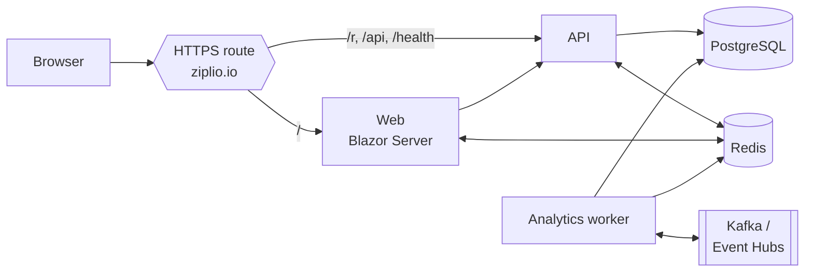

# Ziplio — URL Shortener

[](https://github.com/mike-inman/SchwabUrlShortener/actions/workflows/ci.yml)

**Live:** <https://ziplio.io> · **[Engineering Summary](docs/ENGINEERING-SUMMARY.md)** · **[Architecture Addendum](docs/ARCHITECTURE-ADDENDUM.md)** · **[Roadmap](docs/ROADMAP.md)**

A production-minded URL shortener built in .NET 10 for the Charles Schwab *AI-Proficient Software Engineer* assignment. The repository and solution are named `SchwabUrlShortener`; the product is **Ziplio**.

> **Reviewers:** start with the [Engineering Summary](docs/ENGINEERING-SUMMARY.md). It maps every assignment requirement and deliverable to evidence, including how AI was used, controlled and validated.

## What it does

- **Guest links:** shorten any `http(s)` URL without an account. Guest links expire after 7 days and record no analytics.
- **Managed links:** sign in with a Ziplio account (Microsoft Entra External ID). Links belong to a workspace and are permanent.
- **Analytics:** clicks on managed links are counted through a transactional outbox and Kafka (Azure Event Hubs in the cloud). A per-link Insights page shows bot-excluded clicks over time, estimated unique visitors, busiest hours, top referrers and devices. Visitors are counted with a privacy-preserving daily hash; raw IPs and user agents are never stored.
- **Live dashboard:** counts and charts update in the browser without polling or refreshing, using Redis pub/sub and the existing Blazor connection.
- **Fast redirects:** `GET /r/{code}` is served from a Redis cache, with PostgreSQL as the source of truth.

## Try it

### On the live site

Open <https://ziplio.io>, paste a URL and select **Create guest link**. To see managed links, analytics and live updates, select **Sign in** and create an account.

### Locally, with Docker

You need Docker (with Compose v2) and Git. The .NET SDK isn't required.

```sh
cp deploy/local.env.example deploy/local.env     # then set POSTGRES_PASSWORD to any long random value
docker compose --env-file deploy/local.env -f compose.yaml -f compose.local.yaml up --build -d
curl -s http://localhost:8080/health/ready        # wait for "Healthy" (the first build takes a few minutes)
```

Open <http://localhost:8080> and create a guest link. Sign-in is disabled locally until you register your own Entra External ID application, so local runs are guest-only; managed features are available on the live site.

Stop with `docker compose --env-file deploy/local.env -f compose.yaml -f compose.local.yaml down --volumes`.

Full instructions (running from the Git bundle, the API with `curl`, troubleshooting) are in [Engineering Summary §9](docs/ENGINEERING-SUMMARY.md#9-setup-instructions).

### Run the tests

```sh
docker compose -p ziplio-tests --env-file deploy/local.env \
  -f compose.yaml -f compose.local.yaml -f compose.test.yaml --profile test up --build --exit-code-from tests tests
docker compose -p ziplio-tests -f compose.yaml -f compose.local.yaml -f compose.test.yaml down --volumes
```

This runs the unit, Web and integration suites against real PostgreSQL, Redis and Kafka in a disposable project. The integration tests run only against a database named `Schwab_test_local`.

## Architecture at a glance



On Azure it runs on Container Apps (autoscaling API 1→5, Web 1→3, Analytics 1→4 on Kafka lag), with private PostgreSQL, Key Vault, one managed identity per service, and everything defined in Bicep. Details are in the [Architecture Addendum](docs/ARCHITECTURE-ADDENDUM.md).

## Repository layout

| Path | Contents |
| --- | --- |
| `src/Shortener.Domain` | Entities and rules: URL and code validation, expiry |
| `src/Shortener.Application` | Use cases and ports |
| `src/Shortener.Infrastructure` | EF Core and PostgreSQL, Redis, outbox, migrations |
| `src/Shortener.Api` | Minimal API: create, redirect, managed reads and analytics, health |
| `src/Shortener.Web` | Blazor Server UI: guest form, dashboard, Insights |
| `src/Shortener.Analytics` | Outbox publisher, Kafka consumer, aggregation |
| `tests/` | Unit, Web (bUnit) and integration tests |
| `infra/` | Bicep, azd and Entra configuration for Azure |
| `.github/` | CI (build, tests, vulnerability, secret and image scans) and gated deploy |
| `compose*.yaml`, `deploy/` | Local, scale-out, cloud-VM and test Compose layouts |
| `docs/` | Engineering summary, architecture, runbooks, and dated plans, handoffs and validations |

## Documentation

- [Engineering Summary](docs/ENGINEERING-SUMMARY.md): requirements, AI-assisted process, validation, scenarios, setup, trade-offs.
- [Architecture Addendum](docs/ARCHITECTURE-ADDENDUM.md): diagrams, Azure topology, security, scaling, decision log.
- [Product Roadmap](docs/ROADMAP.md): QR codes, an MCP server for AI agents, and an in-app AI assistant.
- [Configuration and local operations](docs/runbooks/configuration-and-local-operations.md): every setting, manual `dotnet run`, existing-volume bundle.
- [CI/CD runbook](docs/runbooks/ci-cd.md): pipeline gates, approvals, rollback.
- [Azure infrastructure](infra/README.md): provisioning and operations.
- `docs/YYYY-MM-DD-HHMM-*.md`: the dated record of every plan, AI handoff and validation, in order.
- [`AGENTS.md`](AGENTS.md): the rules the AI agents worked under.
