# Ziplio — Architecture Addendum

**Companion to:** [Engineering Summary](ENGINEERING-SUMMARY.md) · **Updated:** 2026-10-14 · **Live:** <https://ziplio.io>

This addendum describes the system's structure, how requests and events move through it, how it is deployed on Azure, and why the key decisions were made. The diagrams are Mermaid, so GitHub renders them inline.

## Contents

1. [System context](#1-system-context)
2. [Logical components](#2-logical-components)
3. [Code structure](#3-code-structure)
4. [Request flows](#4-request-flows)
5. [Click analytics pipeline](#5-click-analytics-pipeline)
6. [Live dashboard updates](#6-live-dashboard-updates)
7. [Identity and authorization](#7-identity-and-authorization)
8. [Data model](#8-data-model)
9. [Azure deployment topology](#9-azure-deployment-topology)
10. [Security architecture](#10-security-architecture)
11. [Scaling and cost posture](#scaling-and-cost-posture)
12. [Resilience and failure modes](#12-resilience-and-failure-modes)
13. [Observability](#13-observability)
14. [Delivery pipeline](#14-delivery-pipeline)
15. [Local and portable runtimes](#15-local-and-portable-runtimes)
16. [Architecture decision log](#16-architecture-decision-log)

---

## 1. System context

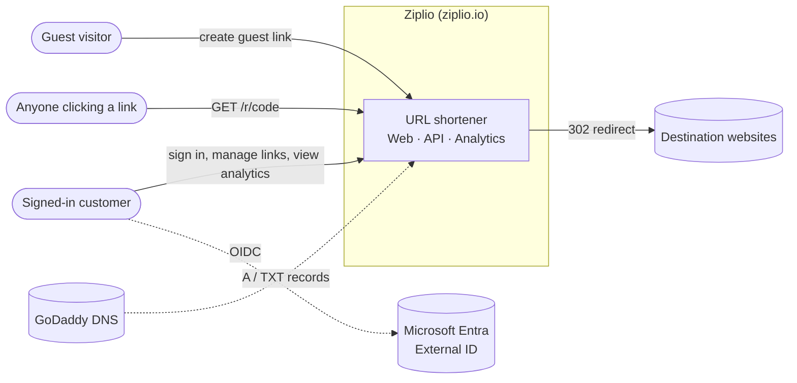

| Actor | Capabilities |
| --- | --- |
| Guest | Create a link that expires after 7 days. No account, no analytics. |
| Customer | Sign in through External ID (email one-time code). Owns workspaces; creates permanent managed links; sees click counts update live. |
| Clicker | Follows any active link. Managed clicks are counted asynchronously. |

---

## 2. Logical components

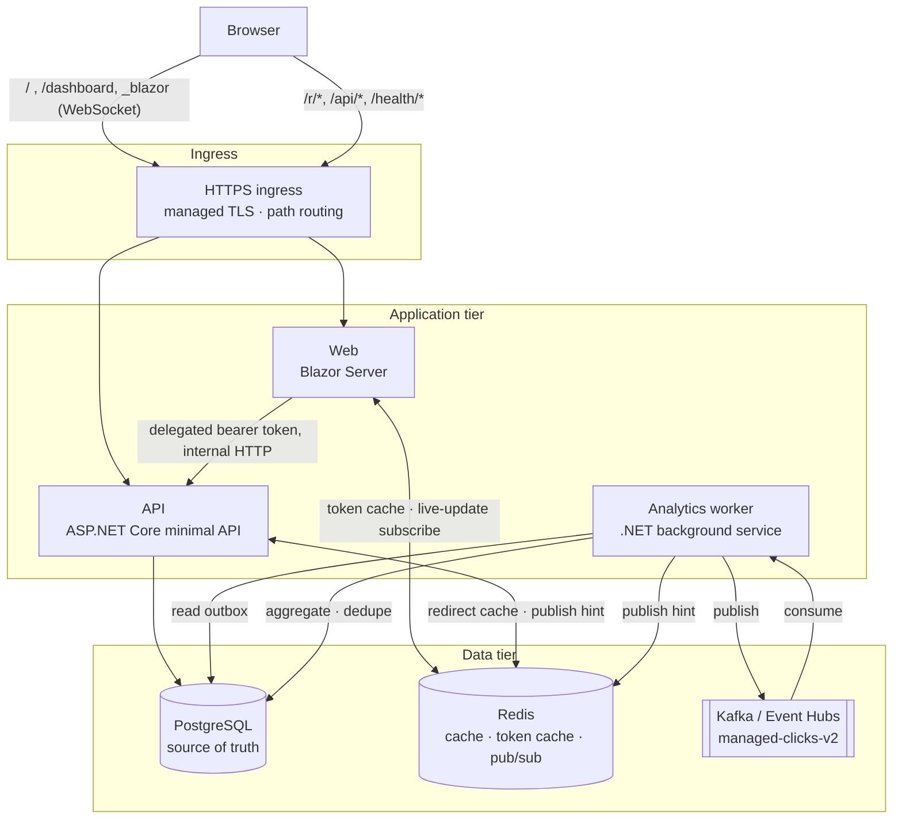

| Component | Responsibility | Scales on |
| --- | --- | --- |
| **Web** | Guest form (static server rendering), sign-in, workspace dashboard. Holds tokens server-side and calls the API on the user's behalf. | HTTP concurrency (sticky sessions for Blazor circuits) |
| **API** | Create, redirect and read endpoints; authorization; rate limiting; writes outbox rows on managed redirects. | HTTP concurrency |
| **Analytics worker** | Outbox publisher; Kafka consumer; idempotent aggregation; dead letters; live-update hints. | Kafka consumer lag (KEDA) |
| **PostgreSQL** | Links, workspaces, memberships, outbox, processed events, dead letters. | Vertical (B1ms → GP) |
| **Redis** | Redirect cache-aside; distributed token cache; pub/sub channel `shortener:links:v1`. | Vertical |
| **Kafka / Event Hubs** | Durable, partitioned click stream (32 partitions in Azure). | Throughput units |

---

## 3. Code structure

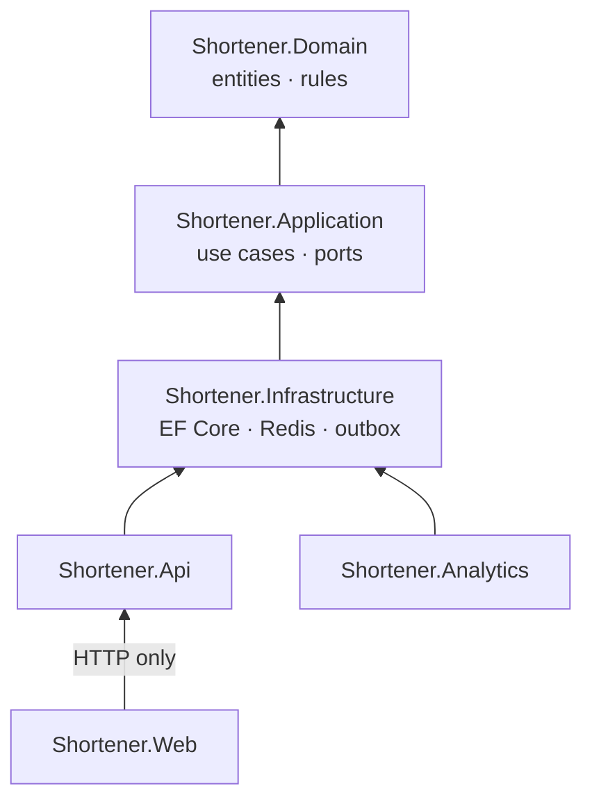

- **Dependencies point inward.** Domain has no dependencies. Application defines ports (repository, cache, clock, authorization). Infrastructure implements them. Hosts compose them.
- **The Web app does not reference Infrastructure or touch the database.** It is a pure API client, so every managed read goes through the same authorization path.
- **Startup never changes the schema.** Migrations run as a separate `--migrate` command: the Compose `migrate` service locally, the `caj-shortener-migrate` job in Azure. That job uses its own identity and a separate connection secret.

---

## 4. Request flows

### Guest create

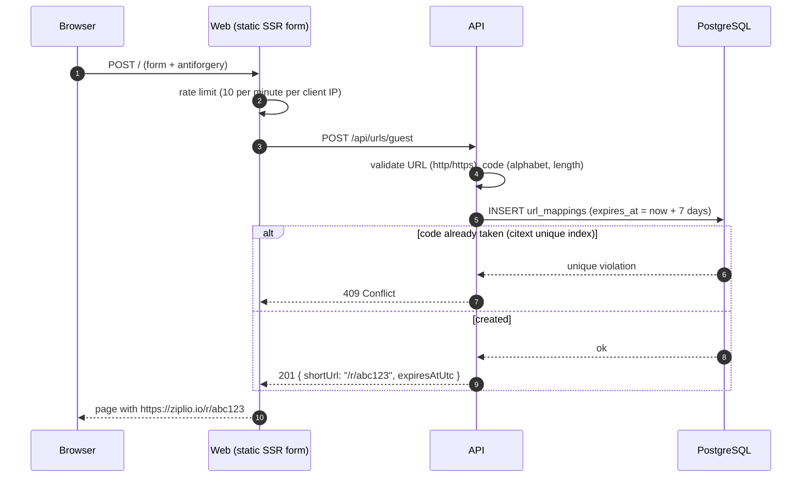

### Redirect (the hot path)

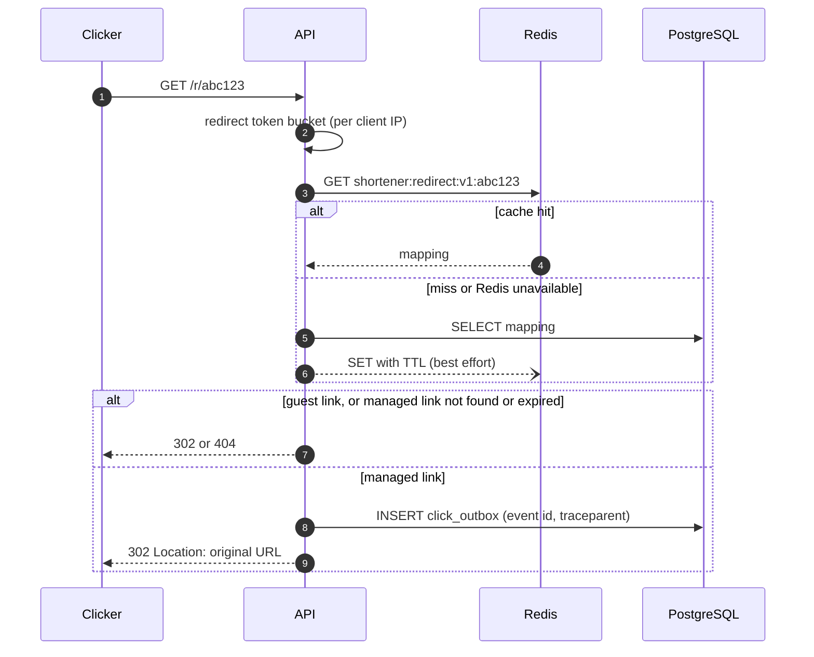

For managed links the outbox row is committed **before** the 302 is returned. A redirect is never answered without its click being durably recorded, and it never waits on Kafka.

---

## 5. Click analytics pipeline

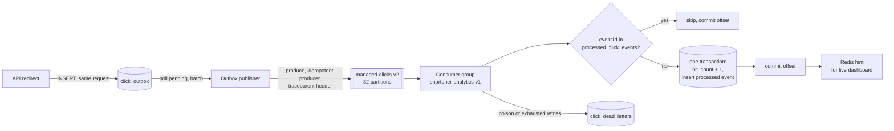

- **Outbox and inbox.** The outbox is `click_outbox`, written in the redirect request. On the consuming side Kafka serves as the inbox (durable, replayable, acknowledged only after commit), and `processed_click_events` is the dedupe record of the idempotent consumer. See decision #19.
- **Delivery is at least once; the effect is exactly once.** The aggregate update and the dedupe record commit in one PostgreSQL transaction, and the offset is committed afterwards. A redelivered event is detected and skipped.
- **Back-pressure is visible.** Unpublished outbox rows and consumer lag are both observable, and in Azure, KEDA scales the worker from 1 to 4 replicas when lag exceeds 50.
- **Tracing.** The W3C `traceparent` is stored in the outbox and carried as a Kafka header, so one trace spans redirect → publish → consume → aggregate.
- **Event versions.** V1 events are tenant-scoped (workforce mode); V2 events are workspace-scoped. Both are consumed, so links from before the workspace migration keep counting.
- **Insights (V3 events).** Managed clicks also carry a privacy-preserving visitor hash: an HMAC keyed by a secret in Key Vault, rotated daily. Bots are flagged. The worker writes UTC-bucketed click facts and pre-aggregates them, so the Insights page and the dashboard sparklines read from indexed aggregates: 80 ms for a 7-day read over 100,000 clicks in tests. Visitor hashes are kept for 35 days, then deleted. Raw IPs and user agents are never stored.

---

## 6. Live dashboard updates

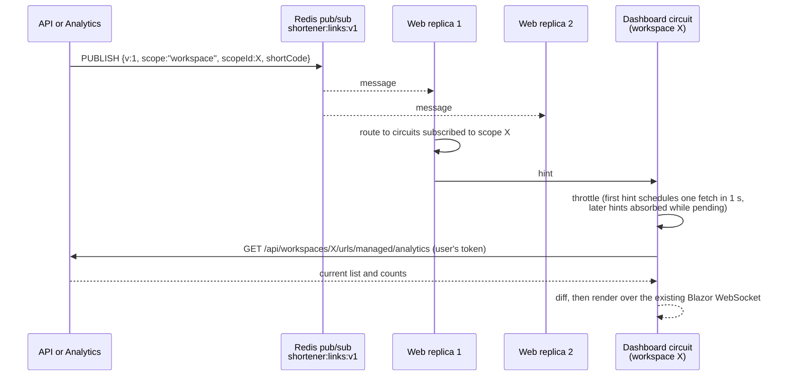

- **The message is a hint, not data.** It carries no URL, count or user identity, so a leaked message reveals nothing. The dashboard always re-reads through the authorized API.
- **One Redis subscription per Web replica,** with in-process fan-out by scope.
- **If Redis disconnects, the dashboard shows a warning** and resynchronizes on reconnect. There is deliberately no hidden polling fallback.

---

## 7. Identity and authorization

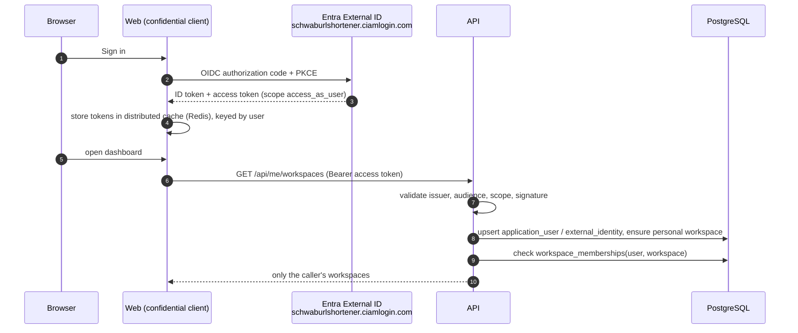

- **Tokens never reach the browser.** The browser holds only an encrypted authentication cookie. Data Protection keys live in Azure Blob storage, wrapped by a Key Vault key, so any Web replica can read the cookie.
- **Authorization is server-side.** A workspace ID in the URL is only a request. The API checks membership from the validated subject before reading any workspace data, and integration tests cover cross-workspace isolation.
- **Two identity modes behind one setting** (`Identity:Mode`). `Customer` (External ID, used in production) and `Workforce` (Entra organizations, tenant `tid` ownership) share the same API surface.
- **App registrations are code.** Redirect URIs, scopes and secrets are applied by `infra/scripts/configure-entra.sh` (Microsoft Graph), not set by hand in the portal.

---

## 8. Data model

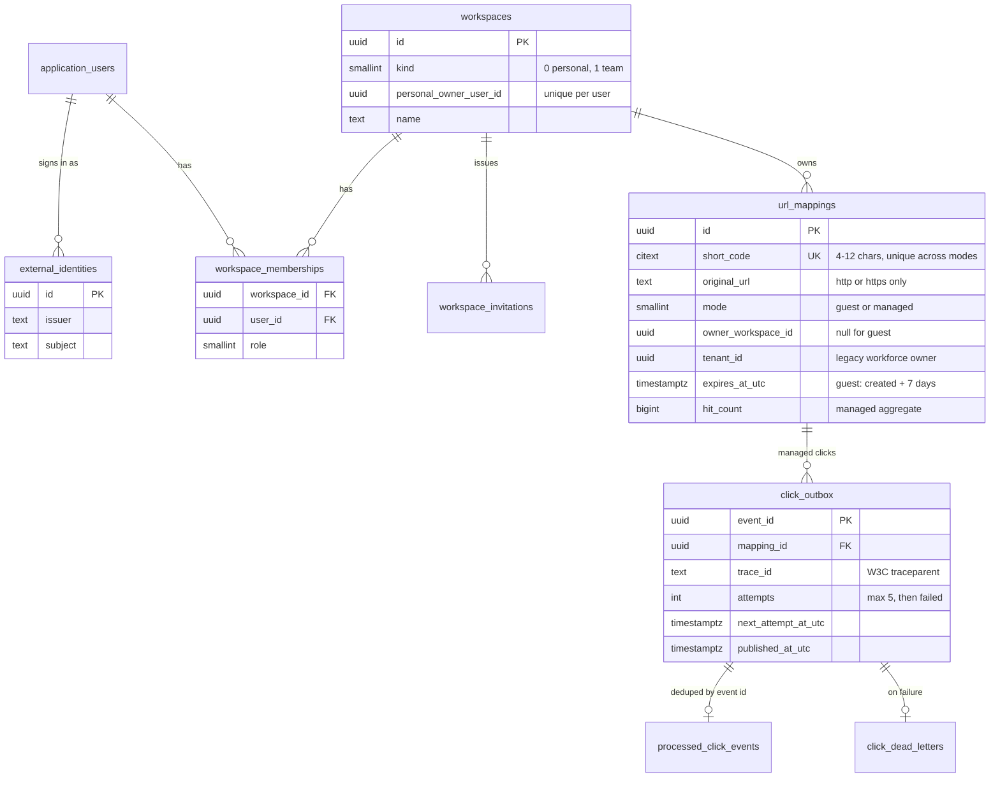

The columns shown are representative and simplified; the EF Core migrations in `src/Shortener.Infrastructure` are authoritative. Short-code uniqueness is enforced by a **database constraint** (a case-insensitive unique index), so concurrent creates cannot both succeed.

---

## 9. Azure deployment topology

Single environment, resource group `rg-schwab-url-shortener`, region **Central US**.

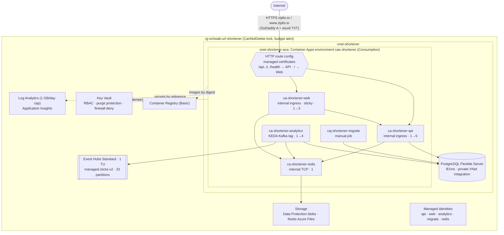

| Resource | Configuration | Why |
| --- | --- | --- |
| Container Apps environment | Consumption profile, VNet-integrated | Pay per use; private access to PostgreSQL |
| HTTP route config | One public hostname; path rules to the API and Web; managed TLS for apex and `www` | One origin for cookies and CSP; no separate proxy container |
| Apps | Internal ingress only; Web has sticky sessions | Only the route is public; Blazor circuits stay on one replica |
| PostgreSQL | Flexible Server B1ms, private VNet integration, `citext` allow-listed, app pool size 2 | Cheapest tier with private networking; the pool fits its 35-connection limit across replicas |
| Redis | Container with an Azure Files volume, password from Key Vault | About $0 extra compared with a managed cache |
| Event Hubs | Standard, 1 TU, Kafka endpoint, 32 partitions, 7-day retention | Kafka protocol without running brokers; partitions allow the worker to scale out later |
| Key Vault | RBAC, purge protection, default deny with a subnet rule, `AzureServices` bypass | Secrets referenced by the apps, never copied into config |
| Identities | One user-assigned identity per workload, each with `Key Vault Secrets User` **per secret** | A compromised app can read only its own secrets |
| ACR | Basic; images built with `az acr build --target` | Deploy by immutable digest |
| Observability | Log Analytics with a 1 GB/day cap; workspace-based App Insights | Cost ceiling on logs |
| Governance | `CanNotDelete` lock, $100 budget alert, tags, Defender CSPM (free tier) | Guardrails for a shared assessment environment |

Everything above is defined in Bicep under `infra/` and driven by `azd`. The Entra app registrations are applied by a Graph script in the same folder.

---

## 10. Security architecture

| Layer | Control |
| --- | --- |
| Edge | TLS with managed certificates for the apex and `www`; `www` → apex 301 |
| Abuse | ASP.NET Core rate limiting: guest create 10/min per IP; redirect token bucket (60 burst, 60 per 30 s); managed 120/min per user |
| Browser | Nonce-based CSP, `frame-ancestors 'none'`, `X-Content-Type-Options: nosniff`, Referrer-Policy, no `Server` header, antiforgery on forms |
| Identity | External ID OIDC with PKCE; delegated scope `access_as_user`; tokens held server-side only |
| Authorization | Workspace membership checked from validated claims for every managed operation |
| Data | PostgreSQL reachable only inside the VNet; secrets only in Key Vault; connection strings only through secret references |
| Workload | Non-root containers (`APP_UID`); one managed identity per service with least privilege |
| Supply chain | Build fails on any vulnerable package; Dependabot; images by digest; CI adds CodeQL, gitleaks and Trivy |
| Process | Agents never see secret values; destructive actions need a human approval; the resource lock prevents accidental deletion |

---

## Scaling and cost posture

**At rest** everything sits at one replica on the Consumption plan, on the cheapest tiers that keep private networking. **Under load** each tier scales on its own signal:

| Tier | Signal | Range | Next step if this saturates |
| --- | --- | --- | --- |
| API | 10 concurrent requests per replica | 1 → 5 | Raise the maximum; Front Door caching of redirects |
| Web | HTTP concurrency (sticky) | 1 → 3 | Raise the maximum |
| Analytics | Kafka consumer lag > 50 | 1 → 4 (up to 32 partitions) | More throughput units; more replicas |
| Redis | — | 1 | Azure Managed Redis (SLA, clustering) |
| PostgreSQL | — | B1ms | General Purpose tier with HA; read replica for analytics reads; PgBouncer |
| Event Hubs | — | 1 TU | Auto-inflate TUs |

**Why redirects scale cheaply:** the hot path is a Redis lookup plus, for managed links only, one small insert. Analytics work happens entirely off the request path.

**The connection budget is designed, not accidental:** B1ms allows 35 connections. At 5 API + 4 worker + 1 migration replica, a pool of 2 each stays well under the limit.

⏳ The measured Azure scale-out and scale-in is pending Track C P3. It will be recorded in a dated validation and linked here.

---

## 12. Resilience and failure modes

| Failure | Behavior | Evidence |
| --- | --- | --- |
| Redis down | Redirects fall back to PostgreSQL; readiness reports degraded; dashboard shows a live-update warning; Web sessions may need to sign in again | Slice 4 and Slice 7 fault tests |
| Kafka / Event Hubs down | Redirects continue; outbox rows queue and drain on recovery | Slice 5 outage test |
| Poison event | Bounded retries, then a dead-letter row; the offset advances so the partition is not blocked | Slice 5 dead-letter offset test |
| Duplicate delivery | Skipped by the `processed_click_events` check | Dedupe integration test |
| PostgreSQL down | Creates fail with an error; cached redirects keep working; managed redirects fail rather than lose clicks | Slice 7 |
| Replica restart | No local state: token cache in Redis, Data Protection keys in Blob storage | Track A tests |
| Bad deploy | CI gates, then approval, then smoke test, then automatic image rollback | ⏳ Track F |

---

## 13. Observability

- **OpenTelemetry in all three hosts**, exported to Application Insights when `APPLICATIONINSIGHTS_CONNECTION_STRING` is set (Azure Monitor distro). Sampling starts at 25% to stay inside the 1 GB/day cap.
- **Traces:** ASP.NET Core, HttpClient, Npgsql, custom Redis spans, plus Kafka producer and consumer spans linked through `traceparent`.
- **Metrics:** `Shortener.*` meters (for example, `shortener.live.received`), plus platform metrics for replicas, CPU and requests.
- **Health:** `/health/live` (process) and `/health/ready` (PostgreSQL migrations plus Redis), wired to Container Apps liveness and readiness probes.
- **Logs:** structured, with hashed client keys for rate-limit events (no raw IPs).

---

## 14. Delivery pipeline

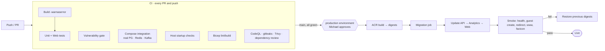

- **Authentication** to Azure uses GitHub OIDC with a dedicated identity: AcrPush plus Container Apps Contributor only, with no Key Vault or Graph rights.
- **Infrastructure changes** (Bicep and Entra) are applied by the operator, with `azd provision --preview` reviewed first. This keeps database passwords and the client secret out of GitHub.
- Status: CI is [green on `main`](https://github.com/mike-inman/SchwabUrlShortener/actions/runs/38593373498). The deploy workflow is merged and stays off (`DEPLOY_ENABLED` unset) until the repository is public and the `production` environment has its required reviewer. ⏳ First gated deploy and rollback test.

---

## 15. Local and portable runtimes

| Compose files | Use |
| --- | --- |
| `compose.yaml` + `compose.local.yaml` | Full stack on `localhost:8080` behind Caddy; guest-only unless Entra values are provided |
| `+ compose.test.yaml --profile test` | Runs every test suite in a container against a disposable `Schwab_test_local` database |
| `+ compose.scaleout.yaml` | Two API and two Web replicas behind Caddy, to exercise scale-out locally |
| `compose.yaml` + `compose.cloud.yaml` | A single VM with a public domain and automatic HTTPS |
| `compose.existing.yaml` (`+ compose.https.yaml`) | Reuse existing named volumes; optional internal HTTPS |

The same images run locally and in Azure. Only configuration differs, and every setting has a safe local default in `appsettings.json`.

---

## 16. Architecture decision log

| # | Decision | Alternatives considered | Rationale |
| --- | --- | --- | --- |
| 1 | Layered (clean) architecture with ports | Single project; vertical feature folders | Testable rules; swappable infrastructure; the Web app is forced through the API |
| 2 | PostgreSQL as the source of truth | SQL Server; Cosmos DB | Relational integrity, `citext`, cheapest private-networked managed tier |
| 3 | Redis cache-aside for redirects | No cache; in-memory cache | Shared across replicas; optional on the redirect path |
| 4 | Transactional outbox + Kafka | Write counts synchronously; fire-and-forget events | No hot-path cost and no lost clicks; replayable |
| 5 | Idempotent consumer with a dedupe table | Rely on exactly-once Kafka semantics | Exactly-once *effect* without a distributed transaction |
| 6 | Blazor Server | React SPA + BFF; Razor Pages | One language; tokens stay server-side; built-in push channel |
| 7 | Redis pub/sub notify-then-fetch | Polling; SSE; SignalR hub; PostgreSQL `LISTEN` | Works across replicas; no data in messages; reuses authorization |
| 8 | External ID + workspaces | Workforce tenant ownership only | A consumer product needs customer accounts and team sharing |
| 9 | Azure Container Apps | AKS; App Service; VMs | Autoscale (including KEDA) without cluster operations |
| 10 | Route config with path rules | Caddy proxy container; Front Door | One origin, managed certificates, no extra container to run |
| 11 | Redis as a container | Azure Cache / Managed Redis | Cost; Redis is not the source of truth |
| 12 | Event Hubs Kafka endpoint | Self-hosted Kafka; Service Bus | Same client code as local Kafka; no brokers to run |
| 13 | Key Vault references + per-service identities | App settings; one shared identity | Least privilege; secrets never in config or Git |
| 14 | DNS stays at the registrar | Azure DNS | Owner's preference; only A and TXT records are needed |
| 15 | `/r/{code}` path | Root-level codes | No collisions with app routes; simple routing rules |
| 16 | App-only CD; operator-applied infrastructure | Full `azd up` in the pipeline | No app secrets or Graph rights in CI |
| 17 | One lean environment | Dev, staging and prod | Assessment budget; protection comes from gates, approval and rollback |
| 18 | **No Azure API Management (yet)**; gateway duties split across the Container Apps route (single entry, path routing, managed TLS), in-app JWT validation and workspace authorization, the ASP.NET Core rate limiter, security-header middleware, Redis caching, and OpenTelemetry | APIM (Consumption or v2 tiers); Front Door with WAF | The API has one first-party client (the Web app) plus public redirects. APIM pays off when the API becomes a product for outside consumers: keys and subscriptions, per-customer quotas, a developer portal, versioning and central policy. At the tiers that support private networking it adds meaningful monthly cost and a network hop for features nothing uses yet. **Trigger to adopt:** a public third-party API (for example API-key shortening or an MCP service); APIM then fronts the API and owns keys, quotas and the portal. Front Door with WAF is the planned edge layer before that. |
| 19 | Transactional **outbox** on the producer, **Kafka as the inbox** with an idempotent consumer (dedupe table written in the same transaction as the aggregate) | Separate inbox table that copies every incoming message before processing | Kafka is already a durable, replayable log and offsets are acknowledged only after the processing transaction commits. A second inbox table would store every event twice without adding a guarantee. The result is an exactly-once *effect* on at-least-once delivery, without distributed transactions. |
