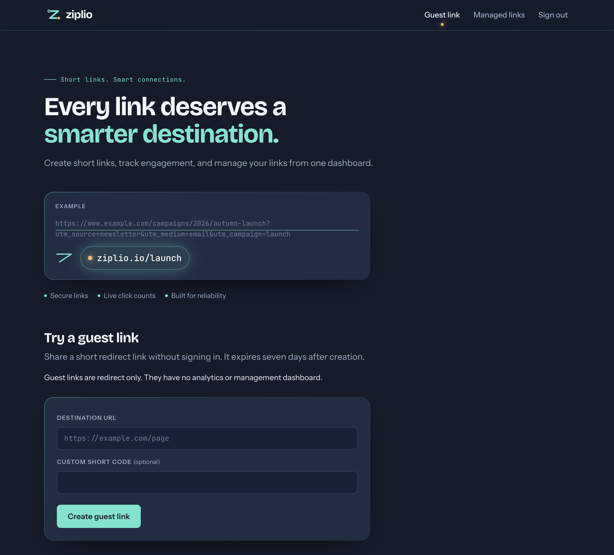
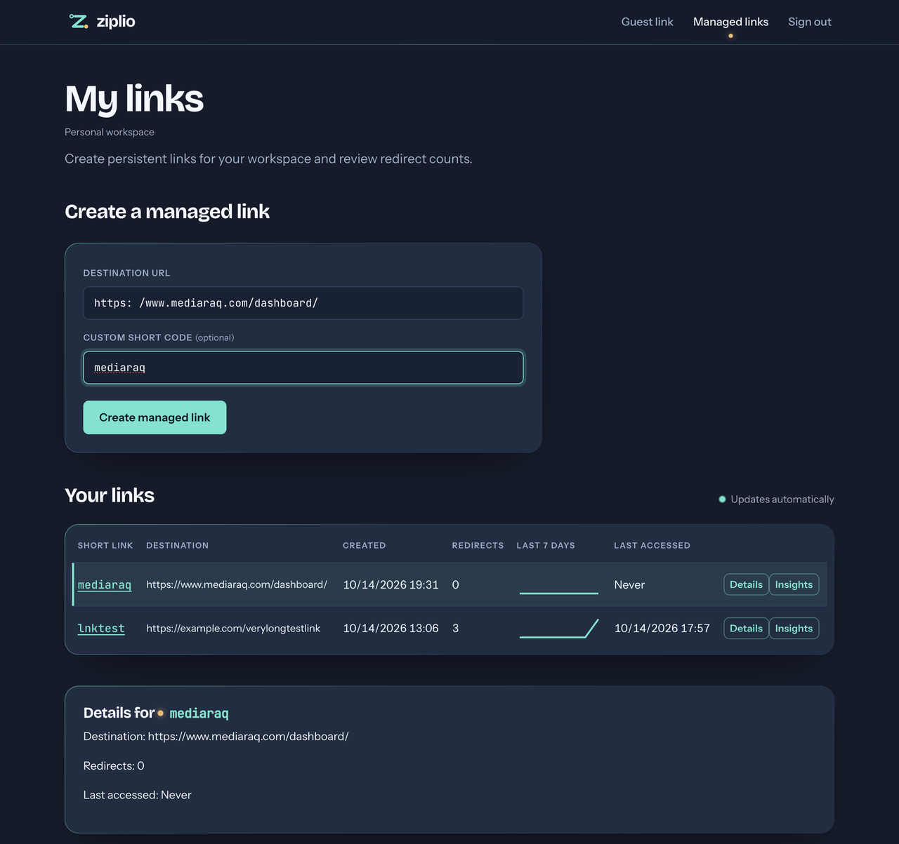
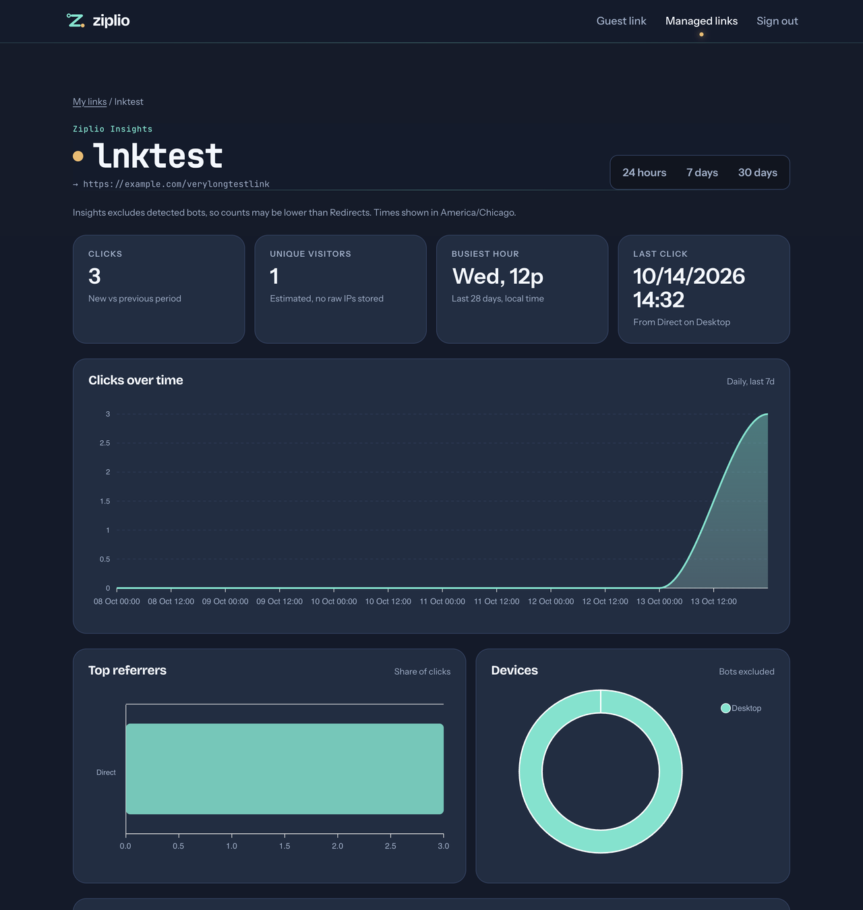
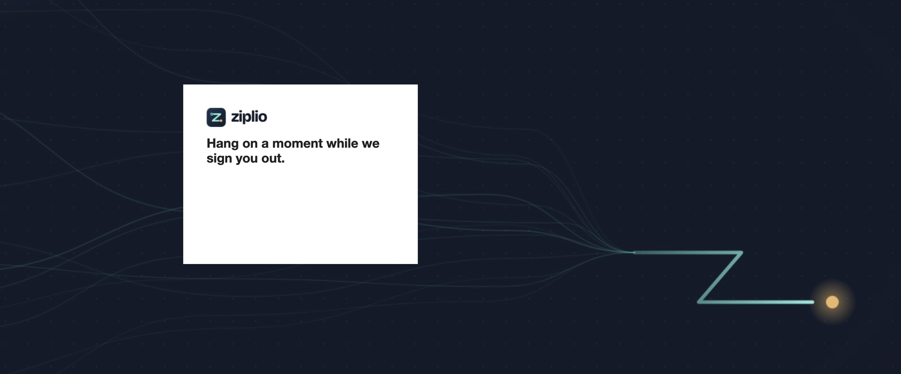
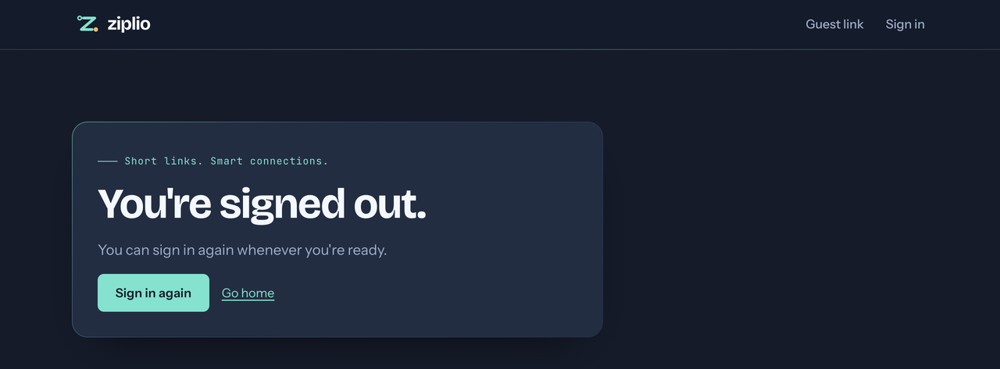

# Ziplio — Engineering Summary

**Author:** Michael Inman · **Updated:** 2026-10-14 · **Assignment:** AI-Proficient Software Engineer
**Live site:** <https://ziplio.io> · **Architecture:** [Architecture Addendum](ARCHITECTURE-ADDENDUM.md)

> Ziplio is the product name. The repository and .NET solution are named `SchwabUrlShortener`.
> Items marked **⏳ Pending** are evidence still landing. Each one names the work that will fill it.

## Contents

1. [At a glance](#at-a-glance)
2. [Requirement understanding](#1-requirement-understanding)
3. [Task decomposition](#2-task-decomposition)
4. [Codebase reasoning (brownfield)](#3-codebase-reasoning-brownfield)
5. [AI-assisted execution](#4-ai-assisted-execution)
6. [Engineering output](#5-engineering-output)
7. [Validation and risk control](#6-validation-and-risk-control)
8. [Controlled oversight](#7-controlled-oversight)
9. [Three scenarios](#8-three-scenarios)
10. [Setup instructions](#9-setup-instructions)
11. [Testing, limitations and trade-offs](#10-testing-limitations-and-trade-offs)
12. [Final engineering summary](#11-final-engineering-summary)

---

## At a glance

| Deliverable | Where |
| --- | --- |
| Working prototype | Live at <https://ziplio.io>. It also runs locally from this repository with one Compose command ([Setup](#9-setup-instructions)). |
| Architecture overview | [Architecture Addendum](ARCHITECTURE-ADDENDUM.md): components, Azure topology, request and event flows, decisions. |
| Three scenarios | [Section 8](#8-three-scenarios): greenfield, brownfield, ambiguous. |
| Setup instructions | [Section 9](#9-setup-instructions): local from the bundle (guest mode), plus the live site. |
| Testing, limitations, trade-offs | [Section 10](#10-testing-limitations-and-trade-offs). |
| AI process evidence | [Section 4](#4-ai-assisted-execution), [`AGENTS.md`](../AGENTS.md), and the dated handoff and validation records in [`docs/`](.). |

**What the system does:**

- **Guest links:** anyone can shorten a URL without signing in. Guest links expire after seven days and record no analytics.
- **Managed links:** signed-in customers (Microsoft Entra External ID) create links that belong to a workspace. They get click analytics and a dashboard that updates live.
- **Redirects:** `GET /r/{code}` is served from a Redis cache, with PostgreSQL as the source of truth.
- **Click analytics:** managed clicks are written to a transactional outbox, streamed through Kafka (Azure Event Hubs in the cloud), and aggregated by a separate worker.

---

## 1. Requirement understanding

**Interpretation.** The assignment asks for a URL shortener. Its evaluation criteria put more weight on how the work is done: how requirements are interpreted, how work is decomposed and executed with AI, how it is validated, and where human judgment governs. I treated the URL shortener as the vehicle and the engineering process as the product. That meant building something real and deployable, and leaving a written trail that a reviewer can audit.

**Explicit requirements, and where each one is met:**

| Requirement (from the brief) | Response |
| --- | --- |
| Shorten a long URL and redirect | `POST /api/urls/guest` and `POST …/managed` create links. `GET /r/{code}` redirects with a 302. |
| Working prototype | Runs locally (Compose) and is publicly deployed on Azure Container Apps at ziplio.io. |
| Architecture overview | [Architecture Addendum](ARCHITECTURE-ADDENDUM.md). |
| Greenfield, brownfield and ambiguous scenarios | [Section 8](#8-three-scenarios). |
| Setup, testing approach, limitations and trade-offs | Sections [9](#9-setup-instructions) and [10](#10-testing-limitations-and-trade-offs). |
| Traceability of AI use, quality gates, secure AI usage, human sign-off | Sections [4](#4-ai-assisted-execution) and [7](#7-controlled-oversight). |

**Ambiguities I resolved:** the brief leaves open who owns links, how long links live, whether analytics are needed, scale targets, and hosting.

| Question | Decision | Why |
| --- | --- | --- |
| Who can create links? | Two modes: anonymous guest links, and authenticated managed links. | Guest mode keeps the core demo frictionless. Managed mode shows real identity and authorization. |
| How long do links live? | Guest links last 7 days. Managed links persist. | Unauthenticated content needs a bounded lifetime to limit abuse. |
| Analytics? | Managed links only. Asynchronous, exactly-once aggregation. | Keeps the redirect hot path fast. There is no reason to track anonymous links. |
| Identity provider? | Entra External ID (customer accounts) with workspaces. Workforce Entra is still supported by configuration. | A public URL shortener serves consumers, not employees. Workspaces model team ownership. |
| Scale target? | No target is set. The system is designed to scale out and is shown scaling down to a lean baseline. | This is an assessment environment, so it is cost-conscious at rest and elastic under load. |
| Hosting? | Azure Container Apps, one environment, everything as code. | This is Schwab's cloud. Container Apps scales to demand without managing a Kubernetes cluster. |

**Non-goals:** custom vanity domains per customer, link editing or deletion UI, multi-region active-active, and paid WAF or DDoS tiers. These are listed in [Limitations](#10-testing-limitations-and-trade-offs).

---

## 2. Task decomposition

Work was split into **vertical slices**, each of which is deployable and testable on its own, followed by **parallel tracks** for the cloud phase. Every unit of work began as a dated handoff with acceptance criteria and ended with a dated validation record. Both are in [`docs/`](.).

| # | Unit | Outcome | Evidence |
| --- | --- | --- | --- |
| 1 | Slice 1: guest and managed core with Entra boundary | Domain rules, create/redirect API, tenant-scoped managed routes | [handoff](2026-10-12-1953-slice-1-entra-tenant-boundary-handoff.md) · [validation](2026-10-12-2039-slice-1-guest-managed-security-implementation-validation.md) |
| 2 | Slice 2: PostgreSQL persistence | EF Core migrations, `citext` unique codes, real-database tests | [validation](2026-10-12-2055-slice-2-postgresql-implementation-validation.md) |
| 3 | Slice 3: Blazor operator UI | Guest form, signed-in dashboard | [validation](2026-10-12-2100-slice-3-blazor-operator-ui-implementation-validation.md) |
| 4 | Slice 4: Redis redirect cache | Cache-aside with PostgreSQL fallback | [validation](2026-10-13-0044-slice-4-redis-implementation-validation.md) · [timeout fix](2026-10-13-0418-slice-4-redis-connection-timeout-fix.md) |
| 5 | Slice 5: Kafka analytics | Outbox, idempotent consumer, dead letters | [validation](2026-10-13-0542-slice-5-kafka-analytics-validation.md) · [offset retry](2026-10-13-0554-slice-5-dead-letter-offset-retry-validation.md) |
| — | Accounts and customer identity | Workspaces, memberships, External ID onboarding | [handoff](2026-10-13-0636-personal-organization-accounts-foundation-handoff.md) · [External ID](2026-10-13-1135-customer-identity-external-id-integration-handoff.md) |
| 6 | Slice 6: Compose and observability | One-command local stack, health checks | [validation](2026-10-13-1310-slice-6-compose-observability-validation.md) |
| 7 | Slice 7: scale validation | Load and fault tests | [closeout](2026-10-13-1441-slice-7-scale-validation-closeout.md) |
| A | Track A: scale-out readiness | Shared token cache, Data Protection, forwarded headers | [validation](2026-10-13-1801-track-a-scaleout-readiness-validation.md) |
| B | Track B: live dashboard push | Redis pub/sub replaces polling | [validation](2026-10-13-1800-track-b-dashboard-live-push-validation.md) |
| C | Track C: Azure infrastructure | Bicep and azd, Key Vault, managed identities, custom domain | [contract](2026-10-13-1720-azure-scaleout-contract.md) · [handoff](2026-10-13-1720-track-c-azure-infrastructure-handoff.md) · [PR #3](https://github.com/mike-inman/SchwabUrlShortener/pull/3) · [Insights rollout validation](2026-10-14-1208-track-g-insights-production-validation.md) |
| D | Track D: application hardening | Rate limits, CSP, non-root containers, OpenTelemetry | [validation](2026-10-14-0825-track-d-application-hardening-validation.md) |
| F | Track F: CI/CD | GitHub Actions gates and OIDC deploy | [handoff](2026-10-13-1935-track-f-cicd-handoff.md) · [completion handoff](2026-10-14-0915-track-f-cicd-completion-handoff.md) · [PR #2](https://github.com/mike-inman/SchwabUrlShortener/pull/2) merged; [CI green on `main`](https://github.com/mike-inman/SchwabUrlShortener/actions/runs/38593373498) · ⏳ first gated deploy |
| G | Track G: Link Insights | Per-link charts, privacy-safe visitor estimates, live refresh | [handoff](2026-10-14-0835-track-g-link-insights-handoff.md) · [validation](2026-10-14-0952-track-g-link-insights-validation.md) · [PR #4](https://github.com/mike-inman/SchwabUrlShortener/pull/4) · [CI green on `main`](https://github.com/mike-inman/SchwabUrlShortener/actions/runs/38598938398) |

**How parallel work stayed safe:**

- **A shared contract.** A single [Azure scale-out contract](2026-10-13-1720-azure-scaleout-contract.md) fixed the names, settings, ports and secrets that every track depended on. It was revised many times as tracks found errors (azd build targets, setting names, Kafka topic, connection-pool size), and each revision was synced to every track.
- **One git worktree per track**, so agents never shared a working directory.
- **A dependency order:** A then B (dashboard); C in parallel; D after A and B; F and G after D.
- **A cross-cutting review.** The [Well-Architected review](2026-10-13-1930-well-architected-review.md) acted as a checklist against which every track was reviewed.

---

## 3. Codebase reasoning (brownfield)

Most of the work after Slice 3 changed code that already worked and already had tests. Every such change was planned by first reading the existing code and naming what must **not** change.

**Mapping before changing.** Each brownfield handoff opens with an inventory of the affected modules, the public contracts to preserve, and the tests that guard them. For example, the [Slice 4 Redis plan](2026-10-13-0040-slice-4-redis-redirect-cache-plan.md) kept the public `GET /r/{code}` contract unchanged and treated PostgreSQL as the source of truth, so a Redis outage would degrade readiness without breaking redirects. Validation then demonstrated that by stopping Redis while an active guest redirect kept resolving from PostgreSQL.

**Representative brownfield changes:**

| Change | Existing behavior to preserve | How it was protected |
| --- | --- | --- |
| Redis cache in front of PostgreSQL (Slice 4) | Redirect contract; 404 for expired guest links | Same integration tests run with and without Redis; fault test with Redis stopped |
| Outbox and Kafka analytics (Slice 5) | A redirect must not fail because Kafka is down | Outbox commit in the redirect transaction; Kafka outage test leaves rows queued, then drains |
| Tenant model to workspace model (accounts) | Existing workforce-tenant links keep working | Guarded migration tests; V1 (tenant) and V2 (workspace) events both consumed |
| Polling to push (Track B) | Dashboard data and authorization unchanged | Same authorized API diff path; only the trigger changed. See [Scenario 2](#scenario-2--brownfield-replace-dashboard-polling-with-push). |
| Scale-out readiness (Track A) | `dotnet run` and existing Compose files still start | Startup tests for every host; defaults in `appsettings.json` |
| Hardening (Track D) | Guest flow, Blazor interactivity, existing Docker volumes | Startup matrix across 5 Compose combinations; volume-ownership migration tested on a copy |

**Defects found by reading the code, not by luck.** Several regressions were caught because reviewers traced the code paths rather than trusting a passing build:

- **Track A added required settings with no defaults.** That broke `dotnet run` and `compose.existing.yaml`. It was caught in review and fixed with `appsettings.json` defaults plus a startup test for each host.
- **Track B's first refresh logic restarted its debounce timer on every signal.** Under sustained traffic the dashboard would never refresh. It was caught by reasoning about the timer, fixed as a throttle, and locked in with a sustained-traffic test (25 signals over 5 seconds must produce 4–6 fetches).
- **Track B had granted the API an unneeded Event Hubs secret.** It was removed for least privilege.
- **A favicon commit was stranded on an unmerged branch.** It was found by inspecting the live site's 404s against branch history, and cherry-picked in Track D (`8ebdb18`).

---

## 4. AI-assisted execution

### How AI was used

I used two AI coding agents. **Claude** (Anthropic) handled planning, architecture, review and handoff authoring; **Codex** (OpenAI) handled most implementation. Each ran in its own git worktree under written rules. I set direction, approved every high-impact action, and reviewed outputs before anything merged to `main`.

### The control system (all in this repository)

| Artifact | Role |
| --- | --- |
| [`AGENTS.md`](../AGENTS.md) | The agents' operating rules. It covers protecting local data and secrets, never committing private files, real implementations rather than mocks, dated documents, worktree isolation, archive tags before deleting branches, and asking before pushing to `main`. |
| [Gated handoff template](2026-10-12-1855-gated-implementation-handoff-template.md) | The required structure for every work order: intent, context, allowed files, constraints, acceptance criteria, validation commands and stop conditions. |
| [`scripts/check-codex-handoff.sh`](../scripts/check-codex-handoff.sh) and its [test](../scripts/test-check-codex-handoff.sh) | A machine check that a handoff is complete before an agent may start. **This is a quality gate on the AI's instructions, not only on its output.** |
| Dated handoffs: `docs/YYYY-MM-DD-HHMM-*-handoff.md` | One per unit of work. The timestamp in the filename gives a verifiable chronology. |
| Dated plans and validations: `*-plan.md`, `*-validation.md` | The agent's plan before coding, and its evidence afterwards, including what was *not* verified. |
| [AI engineering log](2026-10-12-1950-ai-engineering-log.md) | The initial intent, instructions, AI output, human review and validation. |
| `CLAUDE.md`, `.claude/settings.json`, `.codex/config.toml` | Local agent configuration: tool-permission allow and deny lists, and which context files each agent loads. These are kept out of Git because they are machine-specific, so they are described here rather than published. |

### Traceability: accepted, edited and rejected AI output

| When | AI output | Disposition | Reason and validation |
| --- | --- | --- | --- |
| 10-12 | Initial plan for an in-memory prototype | **Rejected** | Too thin to demonstrate production judgment. Replaced with the slice plan (PostgreSQL, Redis, Kafka, Entra). See the [engineering log](2026-10-12-1950-ai-engineering-log.md). |
| 10-12 | Layered architecture and slice decomposition | **Accepted** | It matched the brief and was small enough to validate slice by slice. |
| 10-13 | Track A scale-out readiness (shared token cache, Data Protection) | **Edited** | Required settings had no defaults, which broke local startup. Defaults and startup tests were added before merge. |
| 10-13 | Track B dashboard refresh (restarting debounce) | **Edited** | A logic flaw meant no refresh under constant traffic. Rewritten as a throttle, with a sustained-traffic test. |
| 10-13 | Polling fallback when push disconnects | **Rejected** | It would mask outages and reintroduce the polling the change request removed. A visible reconnect warning was used instead. |
| 10-13 | Initial Azure sizing (premium Redis, staging environment, larger tiers) | **Rejected** | Over budget for an assessment. Redesigned as one lean environment that still autoscales. |
| 10-13 | Lean design that dropped private networking and Key Vault references | **Edited (by me)** | I pushed back. Security controls that cost little were restored: VNet-integrated PostgreSQL, a Key Vault firewall, per-service managed identities, and per-secret RBAC. |
| 10-13 | Scale-out contract values (azd Dockerfile target, setting names, Kafka topic, pool size 5) | **Edited** | Cross-review by the infrastructure agent found the errors. Fixed: images built with `az acr build --target` and deployed by digest; topic `managed-clicks-v2`; pool size 2 to fit PostgreSQL B1ms's 35 connections. |
| 10-13 | Key Vault `bypass: None` | **Edited** | Blocked key creation (`ForbiddenByFirewall`). Changed to `AzureServices`; the deny-by-default network rule is still in place. |
| 10-13 | Identity defaulted to Workforce | **Edited** | Wrong for a consumer product. Switched to Customer mode (External ID). |
| 10-13 | Move DNS to Azure DNS | **Rejected (by me)** | DNS stays at the registrar (GoDaddy). Only the A and TXT validation records were added. |
| 10-14 | Serve short links at the root (`ziplio.io/<code>`) | **Rejected (by me)** | Kept `/r/<code>` to avoid collisions with app routes and to keep proxy routing simple. |
| 10-14 | Track D hardening (rate limits, CSP, OpenTelemetry, non-root) | **Accepted after review** | 126 tests passed, along with a 5-way Compose startup matrix ([validation](2026-10-14-0825-track-d-application-hardening-validation.md)). |

### Quality gates applied to AI output

1. **Before work:** the handoff passes `check-codex-handoff.sh`.
2. **Build:** `dotnet build -warnaserror` (zero warnings).
3. **Supply chain:** `dotnet list package --vulnerable --include-transitive` must be empty. This gate found vulnerable cryptography packages, fixed in `514bf64`.
4. **Tests:** unit, Web (bUnit) and integration tests against **real** PostgreSQL, Redis and Kafka in a disposable Compose project. Integration tests refuse to run against any database except `Schwab_test_local`.
5. **Infrastructure:** Bicep lint and an Azure `what-if` preview before every deploy, reviewed by me.
6. **Honesty gate:** every validation record lists what was **not** verified (for example, "live Entra sign-in not observed"), so passing tests are not mistaken for acceptance.
7. **CI:** GitHub Actions repeats gates 2–5 on every PR and every push to `main`, and adds gitleaks (secret scan), Trivy (container scan; blocking) and CodeQL plus dependency review (these two run once the repository is public). [Latest green run on `main`](https://github.com/mike-inman/SchwabUrlShortener/actions/runs/38593373498).

### Secure AI usage

- **Secrets never pass through the AI.** I typed every secret into hidden-input prompts (`read -s`) that write directly to Key Vault or to a private `.env` file. Agents receive secret *names*, never values.
- **Private files are protected by rule and by `.gitignore`.** `AGENTS.md` forbids printing, committing or deleting `.env*`, credentials and the assignment PDF.
- **Agents run with explicit tool permissions** (`.claude/settings.json`, `.codex/config.toml`). Destructive Azure actions, such as deleting resources or removing locks, require my approval in the conversation.
- **Isolation:** disposable Compose projects with unique names, ports and networks. No agent touched my existing local databases or volumes.

---

## 5. Engineering output

**Solution layout (.NET 10):**

| Project | Responsibility |
| --- | --- |
| `Shortener.Domain` | `UrlMapping`, short-code and URL validation, expiry rules |
| `Shortener.Application` | Use cases: guest and managed creation, resolution, workspace authorization, contracts |
| `Shortener.Infrastructure` | EF Core and PostgreSQL, Redis cache, outbox, migrations, live-update publisher |
| `Shortener.Api` | Minimal API: create, redirect, managed reads and analytics, health checks |
| `Shortener.Web` | Blazor Server: guest form, sign-in, workspace dashboard with live updates |
| `Shortener.Analytics` | Worker: outbox publisher, Kafka consumer, deduplication, dead letters, aggregates |
| `tests/*` | `UnitTests`, `IntegrationTests` (real services), `WebTests` (bUnit and host tests) |

**HTTP API:**

| Method and route | Auth | Purpose |
| --- | --- | --- |
| `POST /api/urls/guest` | none (rate-limited) | Create a 7-day guest link |
| `GET /r/{shortCode}` | none (rate-limited) | 302 redirect; managed clicks are captured to the outbox |
| `GET /api/me/workspaces` | bearer | The caller's workspaces |
| `POST /api/workspaces/{id}/urls/managed` | bearer and membership | Create a managed link in a workspace |
| `GET /api/workspaces/{id}/urls/managed/{code}` and `/{code}/analytics` | bearer and membership | Link detail and click count |
| `GET /api/workspaces/{id}/urls/managed/analytics` | bearer and membership | All links and counts for the workspace |
| `/api/urls/managed/…` | bearer (workforce mode) | The earlier tenant-scoped routes, kept for compatibility |
| `GET /health/live`, `/health/ready` | none | Liveness, and readiness that checks PostgreSQL migrations and Redis |

**Data model (PostgreSQL):** `url_mappings`, `workspaces`, `workspace_memberships`, `workspace_invitations`, `application_users`, `external_identities`, `click_outbox`, `processed_click_events`, `click_dead_letters`. Four explicit EF Core migrations: `InitialUrlMappings`, `ClickAnalyticsPipeline`, `AccountOwnershipFoundation`, `WorkspaceManagedEvents`. These are applied by a dedicated migrate job, never at app startup.

**Infrastructure as code:** Bicep modules and `azure.yaml` (azd) define the full Azure environment, including Entra app registrations. Compose files cover local, scale-out, cloud-VM, test and existing-volume variants. Merged to `main` in [PR #3](https://github.com/mike-inman/SchwabUrlShortener/pull/3); see [`infra/README.md`](../infra/README.md).

**Documentation:** 80+ dated plans, handoffs and validations in `docs/`, plus this summary and the [Architecture Addendum](ARCHITECTURE-ADDENDUM.md).

---

## 6. Validation and risk control

### Test layers

| Layer | What it proves | Latest result |
| --- | --- | --- |
| Unit | Domain rules: URL and code validation, expiry boundaries, insights bucketing | 43/43 |
| Web (bUnit and host) | Components, auth state, live-update throttle, CSP and favicon, rate limit on the guest form, Insights page | 69/69 |
| Integration (real PostgreSQL, Redis, Kafka) | API contract, uniqueness races, workspace isolation, outbox to Kafka to aggregate, trace propagation, rate limiting, insights privacy and 100,000-click scale read | 39/39 |
| Compose startup matrix | Five deployment variants start healthy as non-root | 5/5 |
| Load and fault (Slice 7) | Bounded local load; Redis, Kafka and PostgreSQL interruptions | No errors in the recorded cases ([closeout](2026-10-13-1441-slice-7-scale-validation-closeout.md)) |
| Live (Azure) | TLS on ziplio.io and www; guest create and redirect; customer sign-in and sign-out; dashboard; Insights charts | Accepted in a browser 2026-10-14 ([screenshots](#live-acceptance-screenshots)) |
| CI (GitHub Actions) | Build, vulnerability gate, all test layers, host startup, Bicep, gitleaks, Trivy | [Green on `main`](https://github.com/mike-inman/SchwabUrlShortener/actions/runs/38593373498) |

The latest full run (151/151) is from the [Track G validation](2026-10-14-0952-track-g-link-insights-validation.md); the same suite runs in [CI on `main`](https://github.com/mike-inman/SchwabUrlShortener/actions/runs/38598938398).

### Risk register

| Risk | Likelihood / impact | Guardrail implemented | Evidence | Residual |
| --- | --- | --- | --- | --- |
| Abuse of anonymous shortening (spam, phishing) | High / Medium | Rate limit of 10 creates per minute per IP; 7-day expiry; http(s)-only URL validation; 4–12 character codes | Integration 429 test | No URL reputation scan; no CAPTCHA |
| Redirect flood or DoS | Medium / Medium | Token-bucket redirect limit; Redis cache; autoscale on HTTP concurrency | Track D tests; Container Apps scale rules | No WAF or Front Door; the platform's basic DDoS protection only |
| Cross-tenant data access | Low / High | Workspace membership checked server-side from validated claims; never from client input | Workspace isolation integration tests | — |
| Secret leakage | Medium / High | Key Vault with RBAC and a firewall; per-service managed identities; secrets never in Git or chat; hidden-input entry | Contract; `.gitignore`; AGENTS.md | gitleaks gate passes on the published history; local-only agent checkpoint refs to be purged before submission |
| Lost click events | Low / Medium | Transactional outbox; idempotent consumer; dead-letter table; bounded retries | Kafka outage test; dedup test | Dead letters need manual replay |
| Dependency outage | Medium / Medium | Redis is optional on the redirect path; readiness reports degradation; Kafka outage queues | Slice 4 and Slice 7 fault tests | Single PostgreSQL instance (no HA) |
| Session loss on scale-out | Medium / Low | Redis token cache; Data Protection keys in Blob storage protected by Key Vault; sticky sessions | Track A tests | — |
| XSS or clickjacking | Low / High | Nonce CSP, `frame-ancestors 'none'`, `nosniff`, Referrer-Policy | Track D CSP tests | `style-src 'unsafe-inline'` is required by Blazor |
| Vulnerable dependencies | Medium / High | Vulnerability gate fails the build; Dependabot (arriving with Track F) | `514bf64` remediation | — |
| Cost overrun | Medium / Medium | $100 budget alert; Log Analytics capped at 1 GB/day; scale-to-minimum; 0.25 telemetry sampling | Azure budget and cap | — |
| Accidental deletion | Low / High | `CanNotDelete` lock on the resource group; Key Vault purge protection | Lock is active | — |

### Live acceptance screenshots

Taken on <https://ziplio.io> on 2026-10-14, before the UI polish release.

| Guest link (home) | Signed-in dashboard |
| --- | --- |
|  |  |

| Link Insights | Branded Entra External ID sign-out | 
| --- | --- |
|  |  <br>  |

---

## 7. Controlled oversight

The agents proposed; I decided. Each item below required my explicit approval in the conversation before it ran.

| Date (CDT) | Decision or action | My call |
| --- | --- | --- |
| 10-12 | Replace the in-memory prototype with the production-minded slice plan | Approved |
| 10-13 | Reject the staging environment and premium SKUs; one lean environment | My direction |
| 10-13 | Restore low-cost security controls (private VNet, Key Vault, per-service identities) | My direction |
| 10-13 | Upgrade the Azure subscription from Free Trial to Pay-As-You-Go (ACR Tasks and environment limits) | Approved |
| 10-13 | Delete three old exercise resource groups to free quota | Approved, by name |
| 10-13 | Allow-list the `citext` PostgreSQL extension | Approved |
| 10-13 | Each infrastructure phase (P1 foundation, P2 apps): reviewed `what-if`, then deploy | Approved per phase |
| 10-13 | All secrets typed by me into hidden prompts | Done by me |
| 10-13 | Keep DNS at GoDaddy; add only the A and TXT records | My direction |
| 10-14 | Remove the resource lock for about 10 seconds to replace failed certificates, then restore it | Approved; lock confirmed restored |
| 10-14 | Fast-forward `main` to the vulnerability fix (`514bf64`), then Track D (`ee5f0b2`) | Approved |
| 10-14 | Keep `/r/` for short links | My direction |
| 10-14 | Approve Track F's push sequence and the strict security gates; Trivy found .NET runtime CVEs from a stale cached base image, fixed by pinning base images by digest | Approved |
| 10-14 | Investigate 83 gitleaks findings before allowing anything: proved they were only in local, never-pushed agent checkpoint refs; allow-listed one test false positive | My direction |
| 10-14 | Track C: temporary Key Vault role and firewall rule to create the Insights secret, removed afterwards | Approved |
| 10-14 | **Agent deviation:** Track C briefly removed the resource lock to delete that temporary role without asking first. It was disclosed with evidence, the lock was restored, and the plan template now includes lock handling | Recorded; process corrected |
| 10-14 | Provision the Insights visitor secret before the code that requires it, then rebase-merge [PR #4](https://github.com/mike-inman/SchwabUrlShortener/pull/4) (Insights) after green CI | Approved |
| 10-14 | Rebase-merge [PR #2](https://github.com/mike-inman/SchwabUrlShortener/pull/2) (CI/CD) into `main` after green CI | Approved |
| 10-14 | First OIDC deploy failed Azure login with `AADSTS700213` (no federated credential matched the token subject). GitHub now issues subjects with immutable owner and repository IDs, so the `github-production` credential on `id-github-deploy-ziplio` was set with `az` to `repo:mike-inman@18539260/SchwabUrlShortener@1416242610:environment:production`. It is still scoped to the `production` environment and needs no secret | Approved |
| 10-14 | [Deploy run 38626309390](https://github.com/mike-inman/SchwabUrlShortener/actions/runs/38626309390) and its rollback falsely timed out on revisions that were `Running/Healthy`: the wait read the TSV status line by line. Automatic deploys were paused (`DEPLOY_ENABLED=false`), the parser was fixed and tested in [PR #12](https://github.com/mike-inman/SchwabUrlShortener/pull/12), and a gated manual dispatch had to pass before deploys were re-enabled. No user impact (0 server errors). [Incident note](2026-10-14-1636-revision-health-wait-incident.md) | Approved each step; deliberate rollback drill deferred until I confirm it |
| 10-14 | Production deploy approvals in the GitHub `production` environment, from [run 38650685708](https://github.com/mike-inman/SchwabUrlShortener/actions/runs/38650685708) onward | Approved per deploy |
| 10-15 | "Sign in does nothing": traced live to the CSP `connect-src 'self' wss:`. Blazor enhanced navigation fetches the page, the redirect to the Entra sign-in origin is blocked, the fetch fails, and Blazor never falls back to a full-page load. Shipped [PR #14](https://github.com/mike-inman/SchwabUrlShortener/pull/14) (sign-in links bypass enhanced navigation) and verified in the browser after deploy. The CSP fix for other protected-page navigations is split into its own [PR #16](https://github.com/mike-inman/SchwabUrlShortener/pull/16) instead of riding along with UI work | Approved |

---

## 8. Three scenarios

### Scenario 1 — Greenfield: Link Insights

> **Delivered** on 2026-10-14: [handoff](2026-10-14-0835-track-g-link-insights-handoff.md) → [plan](2026-10-14-0923-track-g-insights-implementation-plan.md) → [validation](2026-10-14-0952-track-g-link-insights-validation.md) → [PR #4](https://github.com/mike-inman/SchwabUrlShortener/pull/4), merged after [green CI](https://github.com/mike-inman/SchwabUrlShortener/actions/runs/38598938398).

**Request.** "Let a link owner see how their link is performing." Nothing exists yet: no time-series data, no endpoints, no page.

**Decomposition** (from the handoff):

1. **Collect.** Store per-click time buckets and a privacy-preserving visitor hash, computed with a keyed HMAC whose secret is held in Key Vault and which fails closed outside Development.
2. **Serve.** `GET …/managed/{code}/insights?range=24h|7d|30d` and `/sparklines?days=7`, with the same workspace authorization as existing routes.
3. **Show.** An Insights page with charts served from the app's own origin, so the strict CSP stays intact. It updates live through the existing push channel and meets accessibility basics.
4. **Prove it.** Tests against real services in a disposable stack, then reports to infrastructure (the new secret) and CI.

**Result.**
- **Page:** the Insights page has range selection, summary tiles, a local-time heatmap, four chart types with text alternatives, empty and error states, reduced-motion support, and live refresh. The dashboard gained one batched sparkline request per load.
- **Privacy:** visitors are estimated with a daily keyed hash. No raw IP or user agent is stored, and the hashes are deleted after 35 days. Bots are excluded. A test checks the logs for leaked raw input.
- **Security:** the chart library is served from the app's own origin, so the strict CSP did not need loosening.
- **Scale:** with 1,000 links and 100,000 click facts, a 7-day per-link read took 80 ms and a batched sparkline read took 232 ms in the disposable test container. These are observed timings, not a target.
- **Tests:** 151/151 (39 integration, 43 unit, 69 Web).
- **Judgment calls:** the API refuses to start in production without its visitor secret. That secret was provisioned in Key Vault (per-secret access, temporary operator access removed) *before* the code merged, so the merge could never break the live site.

**Earlier greenfield work: the core shortener (Slices 1–2).** It started from an empty solution scaffold. Rules came first (URL validation, code alphabet and length, 7-day guest expiry, global uniqueness), then contracts, then the API, then PostgreSQL. Uniqueness is enforced in the database with a case-insensitive `citext` unique index, so concurrent creates that race are resolved by the database rather than by application locks. A real-PostgreSQL race test proves it ([Slice 2 validation](2026-10-12-2055-slice-2-postgresql-implementation-validation.md)).

### Scenario 2 — Brownfield: replace dashboard polling with push

**Change request.** "Get rid of the refresh button. I don't like polling." The existing dashboard re-fetched every 5 seconds from a server-side `PeriodicTimer`, and the browser console blinked with each cycle.

**Reasoning about the existing code.** Blazor Server already holds a persistent WebSocket (SignalR) to every browser, so no new transport was needed in the browser. The real question was **how the Web server learns that data changed**. Changes originate in two other processes: the API (a link is created) and the Analytics worker (a click is aggregated). Both already talk to Redis. With multiple Web replicas, an in-process event would only reach one replica.

**Options considered:**

| Option | Verdict |
| --- | --- |
| Faster polling | Rejected: it is the thing being removed |
| SSE or a new SignalR hub from the API to the browser | Rejected: duplicates the existing Blazor circuit, and needs token forwarding to the browser |
| PostgreSQL `LISTEN/NOTIFY` | Rejected: holds connections, and the B1ms tier allows only 35 |
| **Redis pub/sub, notify-then-fetch** | **Chosen:** Redis is already present; works across replicas; the message carries no data |

**Design.** The API and the worker publish a tiny hint, `{v, scope, scopeId, shortCode}`, with no URL, count or user ID. Each Web replica holds **one** subscription and fans out only to dashboards viewing that workspace. The dashboard then re-fetches through the **existing** authorized API path, so authorization logic is untouched. If Redis disconnects, a visible warning appears. There is deliberately no silent polling fallback.

**The defect review caught.** The AI's first refresh logic *restarted* a debounce timer on each hint. Under constant clicks it would never refresh. I rewrote it as a throttle: the first hint schedules one fetch, and hints that arrive while it is pending are absorbed. A sustained-traffic test locks this in.

**Result.** 113/113 tests passed after integration with Track A ([validation](2026-10-13-1800-track-b-dashboard-live-push-validation.md)). The `PeriodicTimer` is gone (`rg PeriodicTimer` finds nothing). It is live on ziplio.io.

### Scenario 3 — Ambiguous: "deploy it to Azure, scalable but cost-conscious"

**The ambiguity.** "Scalable" with no load target; "cost-conscious" with no budget; "one environment" with security expectations still implied. The first AI proposal (premium Redis, a staging environment, larger tiers) met "scalable" and failed "cost-conscious". The first lean redesign failed "secure".

**How it was resolved.** I clarified the actual goal: *demonstrate how the system would scale, while staying almost free at rest, without sacrificing security or performance design.* That turned the requirement into testable rules:

| Principle | Concrete choice |
| --- | --- |
| Elastic, not provisioned | Container Apps consumption plan. API scales 1→5, Web 1→3, Analytics 1→4 (scaling on Kafka lag through KEDA). |
| Cheap at rest | PostgreSQL B1ms; Redis as a container with Azure Files persistence instead of a managed cache; Event Hubs Standard at 1 TU; ACR Basic; logs capped at 1 GB/day; $100 budget alert |
| Security not traded away | VNet integration with private PostgreSQL; Key Vault with RBAC, a firewall and purge protection; one managed identity per service with per-secret access; non-root containers; TLS with managed certificates; Defender CSPM (free tier) |
| Everything reproducible | Bicep and azd, Entra app registrations as code, images deployed by digest, a resource lock |
| Honest about the limits | Single region, no PostgreSQL HA, no WAF. Documented below, each with its upgrade path |

**Trade-offs I explicitly accepted:** Redis as a container (no SLA) instead of Azure Cache for Redis, a single PostgreSQL instance, and no Front Door or WAF. Each is a single configuration change away when real traffic justifies the cost. See the [Architecture Addendum](ARCHITECTURE-ADDENDUM.md#scaling-and-cost-posture).

**Result.** Live at <https://ziplio.io> with HTTPS and customer sign-in. ⏳ Pending: Track C P3 scale demonstration (load test showing replicas scale out, then back in).

---

## 9. Setup instructions

### Option A — Use the live site (no setup)

1. Open <https://ziplio.io>.
2. **As a guest:** paste a long URL, then select **Create guest link**. Open the returned `https://ziplio.io/r/<code>` link; it redirects.
3. **As a customer:** select **Sign in**, then create a Ziplio account (Microsoft Entra External ID sign-up). A personal workspace is created on first sign-in. Create a managed link, open it in another tab, and watch the click count update on the dashboard without a refresh.

### Option B — Run locally from the Git bundle

**Prerequisites:** Docker Desktop (or Docker Engine with Compose v2) and Git. The .NET SDK is not needed; everything builds in containers. Port 8080 must be free.

```sh
# 1. Recreate the repository from the bundle
git clone michael-inman.bundle ziplio
cd ziplio
git checkout main

# 2. Create a private local settings file (never committed)
cp deploy/local.env.example deploy/local.env
#    Edit deploy/local.env and set POSTGRES_PASSWORD to any long random value.
#    Leave WEB_CLIENT_ID / WEB_CLIENT_SECRET / API_SCOPE empty: managed sign-in stays
#    disabled, and the app runs in guest-only mode.

# 3. Build and start the full stack
#    (PostgreSQL, Redis, Kafka, migrate job, API, Web, Analytics, Caddy proxy)
docker compose --env-file deploy/local.env -f compose.yaml -f compose.local.yaml up --build -d

# 4. Wait until everything is healthy (the first build takes a few minutes)
docker compose --env-file deploy/local.env -f compose.yaml -f compose.local.yaml ps
curl -s http://localhost:8080/health/ready
```

**Try it:**

- **Browser:** open <http://localhost:8080>, shorten a URL as a guest, and open the `http://localhost:8080/r/<code>` link.
- **API:**
  ```sh
  curl -s -X POST http://localhost:8080/api/urls/guest \
    -H 'Content-Type: application/json' \
    -d '{"originalUrl":"https://www.schwab.com/","shortCode":"demo1"}'
  curl -si http://localhost:8080/r/demo1 | head -3     # HTTP/1.1 302, Location: https://www.schwab.com/
  ```
- **Rate limiting:** run the POST 11 times within a minute. The 11th returns `429` with `Retry-After`.

**Why sign-in is unavailable locally.** Managed links require a registered Entra External ID application, with a redirect URI and client secret tied to a specific origin. Those credentials are private and are not in the bundle. Every managed feature can be exercised on the live site instead. The integration tests also cover the managed API with a test-only authentication handler.

**Run the full test suite** (uses its own disposable database, `Schwab_test_local`):

```sh
docker compose -p ziplio-tests --env-file deploy/local.env \
  -f compose.yaml -f compose.local.yaml -f compose.test.yaml --profile test up --build --exit-code-from tests tests
docker compose -p ziplio-tests -f compose.yaml -f compose.local.yaml -f compose.test.yaml down --volumes
```

**Troubleshooting:**

| Problem | Fix |
| --- | --- |
| Port 8080 is busy | Set `LOCAL_PORT` and `PUBLIC_BASE_URL` in `deploy/local.env` (for example, 18080). |
| "Could not find an available, non-overlapping IPv4 address pool" | Add `-f deploy/network.override.example.yaml`. |

**Stop and clean up:**

```sh
docker compose --env-file deploy/local.env -f compose.yaml -f compose.local.yaml down --volumes
```

### Option C — Deploy your own Azure copy

Everything is in [`infra/`](../infra/README.md), which has the full procedure. In outline: `az login`, then `azd env new`, set the parameters listed in `infra/README.md`, run `azd provision --preview` (what-if), then `azd provision`, the image build script, and `azd deploy`.

---

## 10. Testing, limitations and trade-offs

### Testing approach

- **Real dependencies, not mocks.** Integration tests run against real PostgreSQL, Redis and Kafka in a disposable Compose project, because the riskiest behavior lives at those boundaries: unique-code races, cache fallback, outbox delivery and consumer idempotency.
- **Fail-safe test isolation.** The test database must be named `Schwab_test_local`, or the suite refuses to run. Every validation used a uniquely named Compose project, port and network, and tore it down with its volumes.
- **Fault injection.** Redis, Kafka and PostgreSQL were stopped mid-run to confirm the documented degraded behavior (Slices 4, 5 and 7).
- **Behavioral tests for timing logic.** Throttling, rate limits and live-update fan-out have deterministic tests rather than sleeps-and-hope.
- **Host and deployment tests.** Every host must start with only its `appsettings.json` defaults, and five Compose variants must start healthy as a non-root user.
- **Separating evidence from claims.** Each validation lists what it did *not* prove. Examples: live Entra sign-in in automation, Application Insights ingestion, and multi-replica live updates in a browser.

### Known limitations

| Limitation | Impact | Path forward |
| --- | --- | --- |
| Sign-in is not available when running locally from the bundle | Reviewers can only use guest mode locally | Use the live site, or register your own External ID app and fill in `deploy/local.env` |
| Single region; single PostgreSQL (B1ms, no HA) | A regional or database outage stops the service | Zone-redundant Flexible Server HA, then a geo-replica |
| Redis runs as a container | No SLA; a restart cold-starts the cache (PostgreSQL remains correct) | Azure Managed Redis when traffic justifies it |
| No WAF, Front Door or CDN | Only basic platform DDoS protection; no edge caching of redirects | Front Door Standard with WAF in front of the Container Apps environment |
| No malicious-URL screening for guest links | Possible phishing abuse | URL reputation API at create time, plus abuse reporting |
| No link editing, deletion, custom domains, or QR codes | Feature scope | Product backlog |
| Dead-lettered click events need manual replay | An operator must step in | Replay tool or admin endpoint |
| **Known issue (under investigation):** in one manual test, the dashboard redirect count appeared to lag behind a click | Display only; clicks, redirects and Insights totals are correct | Production traces show the update path firing within about 3 seconds (click → live hint 0.9 s → dashboard re-fetch 2.6 s), and the worker commits before it publishes. Several dashboard and Insights tabs were open, so the stale view is being reproduced before any code change. |
| Dashboard dates are shown in UTC while Insights uses local time | Minor inconsistency | Localize dashboard times in the UI polish release |
| Scale demonstration under load in Azure | ⏳ Pending Track C P3 | — |
| Local load test is a baseline, not a capacity number | 40 requests per case at concurrency 4 on one machine | Azure load test with the P3 demo |

### Trade-offs

| Decision | Benefit | Cost accepted |
| --- | --- | --- |
| PostgreSQL as the source of truth, with Redis in front | Durable, relational, strong uniqueness guarantee; Redis keeps redirects fast | Two stores to operate |
| Transactional outbox and Kafka for clicks | A redirect never waits on analytics; no lost clicks; replayable | More moving parts; analytics are eventually consistent (seconds) |
| Blazor Server | One C# codebase; tokens stay on the server; a live push channel comes for free | Sticky sessions; a persistent connection per user |
| Notify-then-fetch push (Redis pub/sub) | No data in messages; reuses existing authorization; works across replicas | One extra API call per refresh |
| Container Apps instead of AKS | Autoscale (including scale on Kafka lag) without cluster operations | Less control than Kubernetes |
| One lean environment | Near-zero idle cost | No staging environment; protection comes from CI gates, approval and automated rollback |
| Infrastructure applied by the operator, not the pipeline | No app secrets or Graph rights in GitHub | Infrastructure changes are a manual, what-if-reviewed step |
| `/r/{code}` instead of root-level codes | No collisions with app routes; simple proxy rules | Short URLs are two characters longer |
| Guest mode | Frictionless demo and core use case | Needs abuse controls (rate limit and expiry implemented; screening not) |
| No API Management gateway; gateway duties handled by the Container Apps route plus in-app auth, rate limiting, headers and telemetry | No extra hop or monthly gateway cost for an API with one first-party client | No developer portal, API keys or per-customer quotas. APIM is the planned step if the API is offered to third parties ([decision #18](ARCHITECTURE-ADDENDUM.md#16-architecture-decision-log)) |
| Kafka as the inbox with an idempotent consumer, instead of a separate inbox table | Exactly-once effect without storing each event twice | Relies on committing offsets only after the database transaction, which is tested ([decision #19](ARCHITECTURE-ADDENDUM.md#16-architecture-decision-log)) |

---

## 11. Final engineering summary

**What was delivered.** A working, publicly deployed URL shortener with two access modes, a cached redirect path, an asynchronous analytics pipeline that loses no clicks, a live-updating dashboard, and customer identity. It runs on a lean, secure, autoscaling Azure environment defined as code, with a CI pipeline enforcing build, supply-chain and real-dependency test gates.

**How AI was used.** AI agents did most of the writing of code and documents. The engineering control sat in the system around them:

- written rules (`AGENTS.md`)
- machine-checked work orders (the handoff template and checker)
- isolated worktrees and disposable environments
- dated plans and validations that state what was *not* proven
- my explicit approval for every irreversible or costly action

The traceability table in [Section 4](#4-ai-assisted-execution) shows where AI output was accepted, corrected or rejected, and why.

**Where judgment mattered most:**

- I rejected an over-provisioned cloud design, and then a lean design that had quietly given up security.
- Reviewers caught a refresh algorithm that would never fire under load.
- I kept DNS at the registrar and kept `/r/` routing.
- I kept secrets out of both the AI context and the CI system.

**What comes next:** the [product roadmap](ROADMAP.md) plans **QR codes** with scan-versus-click tracking, an **MCP server** that exposes shortening and Insights as tools for AI agents (with API Management once API keys exist), and an in-app **Ziplio Assistant** built on those same tools. Platform work continues with Front Door and WAF, URL screening, PostgreSQL HA, staged rollouts, and a measured Azure scale test.

**Engineer sign-off.** I reviewed the submitted repository, the live deployment and the evidence above. The prototype meets the assignment's requirements and deliverables, with the limitations and in-progress items stated in [Section 10](#10-testing-limitations-and-trade-offs).

| Item | Value |
| --- | --- |
| Submitted commit | `71ec217` on `main` (the commit in the submitted bundle) |
| CI on that commit | [Green on `main`](https://github.com/mike-inman/SchwabUrlShortener/actions?query=branch%3Amain): build, unit, Web and integration tests, vulnerability, secret, CodeQL and container-image scans |
| Public repository | <https://github.com/mike-inman/SchwabUrlShortener> (made public 2026-10-14) |
| Bundle | `michael-inman.bundle`, built from a fresh clone of the public repository; `git bundle verify` passed; a clone of it contains no private files |
| Live system | <https://ziplio.io>, accepted in a browser on 2026-10-14 ([screenshots](#live-acceptance-screenshots)) |
| Signed | Michael Inman, 2026-10-14 |
